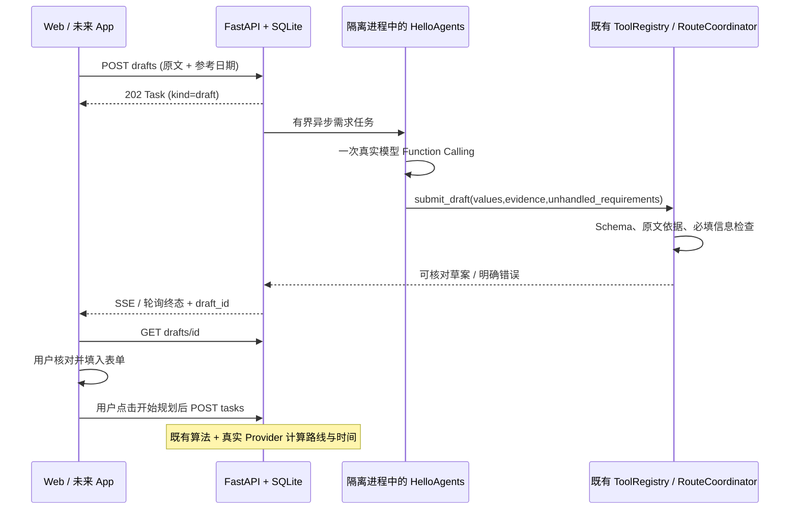

# HelloAgents 单 Agent 需求草案阶段

2026-10-11。接续 [架构审计](TRAVEL_ARCHITECTURE_AUDIT.md)、[交付说明](TRAVEL_DELIVERY.md) 和 [上一轮 Web 增量](WEB_CONTINUATION.md)。用户优先 Web，高德授权稍后提供，移动端仍后置。

2026-10-16 更新：已增加同一草案的结构化补充与确认、修订冲突保护，最新记录见 [需求澄清闭环](DRAFT_CLARIFICATION.md)。下文保留初始模型接入阶段的验证记录。

## 本轮实现与边界

新增 `backend/agent/travel_intake.py`，在既有 `RouteCoordinator`、`ToolRegistry` 边界内适配一个 HelloAgents `FunctionCallAgent`。不运行旧执行计划中的模板 UGC/本地 POI 工具，不增加第二套旅行系统。LLM 只提取用户需求；确认后的规划仍走既有推荐、真实交通矩阵、排序与调度器。

Web 新增自然语言输入、字段原文依据、缺失项、未处理要求和填入表单操作。草案生成不会查询高德，不自动启动规划，不写入已保存行程。填入表单会清除上一份表单的约束与费用覆盖；未给出城市、关键词、日期时留空，其他字段使用明确提示的表单默认值。刷新只保存用户表单和草案/任务 ID，重新向后端获取草案。

`travel_tool_bridge.py` 将既有 ToolRegistry 适配到统一 TravelTools/AmapProvider 三项工具，限制调用次数与期限、返回统一脱敏错误。该桥接已验证，但草案 Agent 只持有 `submit_draft`，不具备在线数据、预订或任意工具能力。MCP stdio 继续使用同一 Provider；当前没有启用 Agent MCP 客户端或高级 Memory。

## 契约与数据流

| 方法 | 路径（前缀 `/api/v1/travel`） | 行为 |
| --- | --- | --- |
| POST | `/drafts` | `DraftRequest{text,reference_date}` → 202 Task，kind=draft |
| GET | `/tasks/{id}` | 原有任务状态；draft 成功返回 draft_id，itinerary_id 保持 null |
| GET | `/tasks/{id}/events` / `/events/stream` | 同一事件轮询/SSE，含解析、校验、协调器、保存阶段 |
| POST | `/tasks/{id}/cancel` | 同一进程终止与幂等取消 |
| GET | `/drafts/{id}` | 用户原文、values、evidence、unhandled_requirements、questions、warnings |
| GET | `/capabilities` | helloagents_available / draft_enabled / llm_configured，仅布尔能力，不返回凭证 |

`Task.kind` 默认 plan，新增 draft_id 为可选；既有任务和行程仍可反序列化。SQLite 只增加 drafts 表，未迁移或删除旧数据。Pydantic 是 Schema 源；已重新导出 OpenAPI 并生成 TS，Web/未来 App 使用同一 `TravelClient.createDraft()` / `draft()`。



初始模型提取时，每个非空字段须有对应原文连续引用，extra 字段、无依据字段、重复提交、越权工具调用和自由文本输出会被拒绝。后续明确补充的字段以用户输入为依据并单独标记来源。原文引用存在不证明模型解释正确：日期推算、预算单位、偏好归类仍须用户核对。不能将 Schema 校验当成语义真实性保证，也不能认为预约等未处理要求已满足。

单草案任务总期限最多 45 秒（包含排队，可由更短 TRAVEL_TASK_TIMEOUT 限制），单 HTTP 调用 12 秒、重试 0、输出上限 1600 tokens。框架在提交后要求的最终自由文本被本地工具回执结束，不再请求第二次模型；回执不是旅行数据。失败、超时、取消和重启使用同一任务机制，无本地解析或模拟业务降级。

## 依赖与运行

保持原 `backend/requirements.txt` 和旅行核心锁文件不变，可选安装：

```powershell
.\.venv\Scripts\python.exe -m pip install -r backend\requirements.helloagents.txt -c backend\requirements.travel.lock.txt
.\.venv\Scripts\python.exe -m pip check
```

使用经过实测的 hello-agents 0.2.9、OpenAI SDK 1.109.1、huggingface-hub 0.36.0，全部扩展依赖记录于 `requirements.helloagents.lock.txt`。当前 hello-agents 1.0.1 对 Pydantic 的上限与已有旅行锁定版本冲突，未升级核心依赖。0.2.9 顶层 import 会加载 evaluation 并依赖 huggingface-hub，因此补齐该导入依赖；本适配不实例化评估、Memory，不下载模型或数据集。

版本依据：[官方包 0.2.9](https://pypi.org/project/hello-agents/0.2.9/)、[当前包依赖元数据](https://pypi.org/pypi/hello-agents/1.0.1/json)、[HelloAgents 官方仓库](https://github.com/jjyaoao/HelloAgents)。实现以实际安装的 wheel 中 FunctionCallAgent API 为依据，避免假定最新主分支接口与教程版本相同。

已有后端 DASHSCOPE_* / OPENAI_* 可复用，或在 `backend/.env` 配置 TRAVEL_LLM_API_KEY、TRAVEL_LLM_BASE_URL、TRAVEL_LLM_MODEL。凭证仅在后端。自定义模型地址须为兼容 Chat Completions 的服务根路径，例如 `/v1`，不是 `/chat/completions`；模型需支持原生 Function Calling。

示例默认关闭解析。启用本地开发终端：

```powershell
$env:TRAVEL_AGENT_ENABLED='1'
$env:LLM_INTENT_DISABLE_LLM='0'
.\.venv\Scripts\python.exe -m uvicorn main:app --app-dir backend --host 127.0.0.1 --port 8000
# 另一个终端
npm run dev
```

访问 `http://127.0.0.1:5173/`，输入需求 → 整理为草案 → 核对原文依据 → 填入表单。真实地点和路线依然需要高德授权；可先单独使用需求草案。当前本地服务使用上述启用标志，`.env` 未修改。重启时按命令显式启用；不具备依赖、模型配置或启用标志时，Web 提示使用直接表单。

## 本轮实际验证

| 验证 | 结果 | 边界 |
| --- | --- | --- |
| Agent tests | 6/6 | 实际 HelloAgents + HTTP MockTransport，仅 tests 注入；校验、禁用/缺配置、越权、重复调用、错误脱敏、桥接预算、202/SSE/持久化，无行程生成 |
| 旅行 API tests | 13/13 | Provider、调度、调整、版本、任务容量/取消/超时/重启 |
| 共享 TS client | 6/6 | 实际 HTTP 禁用/缺 Key 路径及表单、费用、取消/期限；负路径须在禁用解析且无高德 Key 的服务运行 |
| MCP stdio | 1/1 | 真实协议负路径；不是已启用 MCP 客户端 |
| 原有离线回归 | 49/49 | 保留已有行为，不能证明真实授权数据成功 |
| Web build / pip check | 通过 | 核心依赖未升级；仍有既有依赖的弃用提示 |
| 独立测试浏览器 | 通过 | TEST ONLY、独立 8001/5174 与数据库；草案填入和刷新恢复，未自动规划 |
| 真实模型独立调用 | 成功 | 一次普通需求解析，使用已有后端模型配置；未请求高德 |
| 正式 Web → API → HelloAgents | 成功 | 普通需求通过异步任务生成并保存真实草案，填入表单；正式已保存行程仍为 0 |
| 高德、真实路线、多端真机 | 未执行 | Key 后续提供；移动端用户已后置 |

真实模型独立验证证据：忽略提交的 `artifacts/live-intake-verification.json`。正式 Web 任务 `998d070e797842da87ee42f46331ea61`，HTTP 任务/草案/事件证据为 `artifacts/live-web-intake-verification.json`。草案含杭州、2026-10-20、两天、博物馆、步行、800 元预算，均附原文；“需要提前预约”列为未处理。这些是用户需求草案，不是生成的 POI/价格/路线。

可复现单次真实模型验证（会产生模型调用费用，不运行规划或保存行程）：

```powershell
# 同样设置 TRAVEL_AGENT_ENABLED=1 / LLM_INTENT_DISABLE_LLM=0
.\.venv\Scripts\python.exe scripts\verify_live_intake.py --allow-model-call --text '10月20日去杭州玩两天，想看博物馆，全程步行，预算800元，需要提前预约。' --reference-date 2026-10-11
```

正式截图：[真实 Web 需求草案](../../artifacts/travel-web-live-intake.jpg)。隔离测试截图：[TEST ONLY 草案](../../artifacts/travel-web-intake-test.jpg)。截图和真实验证输出不提交。

## 后续顺序

1. 补授权后运行真实高德 POI/路线/编辑成功链路，按真实权限补字段及限流。
2. 在当前受控边界扩展需求澄清和真实工具使用；保持明确授权及调用预算。MCP 客户端要另行验证实际连接，不能以 SDK 安装代替接通。
3. 后续新增 uni-app，复用 API 类型、createDraft/draft 和任务轮询，再做 Web + 真机同后端验证。
4. 完成用户鉴权、数据隔离、持久化队列与部署；随后推进复杂多 Agent/高级 Memory。

完整新增修改文件清单见 [交付说明](TRAVEL_DELIVERY.md#9-新增及修改文件)。
