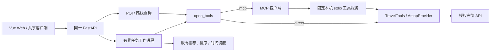

# 统一数据工具的 MCP 客户端

本地实现与验收日期：2026-10-19。使用现有锁定的 MCP SDK 1.26.0 和 AnyIO，不升级核心依赖。参考 [官方 stdio 客户端示例](https://github.com/modelcontextprotocol/python-sdk/blob/v1.26.0/examples/snippets/clients/stdio_client.py) 与 [AnyIO portal 文档](https://anyio.readthedocs.io/en/stable/threads.html#using-asynchronous-context-managers)。

## 调用路径



`TRAVEL_TOOL_TRANSPORT` 由后端配置为 `direct` 或 `mcp`。两条传输路径使用同一个 `TravelTools`、数据契约和 Provider。算法运行在原工作进程内；MCP 服务只提供只读事实查询，不创建 Agent、数据库或第二套行程算法。已有 `online_registry(TravelTools(provider))` 可注入 MCP Provider，测试验证调用和限额。

HelloAgents 的自然语言入口仍只允许 `submit_draft`；确认表单后再启动规划，不让模型计算路线成本或自行承诺预约等要求。后续受控 Agent 工具编排可以复用当前客户端，无须改造前端或复制算法。

## 配置和运行

按根 README 安装 `backend/requirements.mcp.txt` 及其兼容约束，在后端 `.env` 设置：

```dotenv
TRAVEL_TOOL_TRANSPORT=mcp
TRAVEL_MCP_CONNECT_TIMEOUT=8
TRAVEL_MCP_CALL_TIMEOUT=12
TRAVEL_MCP_TOTAL_TIMEOUT=150
TRAVEL_MCP_MAX_CALLS=64
```

重启现有 FastAPI，不额外启动 HTTP 服务。客户端固定用当前 Python 执行 `-m travel.mcp_server`，工作目录为 `backend/`。不能由前端、模型或请求参数指定命令、路径、网络服务或额外工具。只向工具进程传递高德配置及基础运行环境；不传模型或 GitHub 凭证。独立启动的服务也只从 `.env` 读取高德设置。

允许的工具只有 `search_pois`、`get_poi`、`get_route`。握手检查工具目录及输入字段；每次调用校验参数，成功结果必须带 `structuredContent.data` 并通过相同 Pydantic 业务模型。拒绝文本替代结果、未知工具、POI ID 不匹配、重复/超限 POI、缺少路网折线或交通方式不匹配的路线。外部错误只映射约定错误码和固定可读消息，忽略未知错误原文。

次数上限允许 1–128，握手最长 30 秒、单次最长 60 秒、总调用窗口最长 180 秒；无效、非有限数值配置明确报错。单次超时后会话不可继续使用，无自动重连、重试或传输降级。任务级总时限还包括排队、工具启动和算法执行。

规划任务复用一次 MCP 会话；单个同步查询请求使用独立短会话，在 FastAPI 线程池内执行。AnyIO portal 让异步 stdio 上下文在同一任务内进入和退出；同步算法不进入 API 的事件循环。退出会话后由 SDK 关闭输入并有界回收工具进程。任务管理器继续负责取消和超时终结，Windows 本地测试直接检查工具子进程是否已退出。

## 检查接口与 Web

`POST /api/v1/travel/tool-service/check` 不接受执行参数，只握手和列工具，不调用模型、POI 或路线接口。响应包含：

- `transport`：当前后端选择的调用方式。
- `mcp_state`：本次检查的 `available` 或 `unavailable`。
- `checked_at`、`tools`：检查时间和本地允许的工具。
- `provider_configured`、`error`：地图授权配置标记和脱敏错误。

`provider_configured` 只表示填入 Key，不表示权限、配额或真实成功查询已验证。`mcp_state=available` 是本次短会话握手结果，不表示后台存在永久长连接。旧 `Capabilities.mcp_connected` 保持兼容默认值，不用作新接口的状态来源。

Web 在“预算与约束”右侧提供“数据工具连接 → 检查工具连接”。协议检查结果和地图授权分开显示。OpenAPI 与生成 TypeScript 类型纳入同一契约，后续 App 可复用 `checkToolService()`。

## 本地验收与边界

运行 `python scripts/verify_repository.py` 和 `python scripts/verify_browser.py`。当前完整计数见 [验收记录](../ACCEPTANCE.md)，包含本页的 11 项 MCP 客户端检查。验收在 Windows 本地进行，未上传本轮源码、未触发云端 CI。

成功数据只来自 `tests/mcp_fixture_server.py` 的显式测试进程；它复用生产 MCP 服务的工具注册，仅在测试进程内注入 FixtureProvider。生产没有切换至测试服务的配置。真实随仓库服务的握手与缺 Key 拒绝链路均已验证，真实高德成功查询在合法授权后进行。

登录与按用户隔离已在后续模块接入，见 [AUTH_ISOLATION.md](AUTH_ISOLATION.md)。当前调用路径支持单 API 实例的本地空间或账号空间；跨平台进程生命周期和公网部署另行验收。

## 文件改动

| 文件 | 用途 |
| --- | --- |
| `backend/travel/mcp_client.py` | 握手、会话、限额、错误与结果校验、同步 Provider 适配 |
| `backend/travel/tool_runtime.py` | 固定传输选择与无业务调用的连接检查 |
| `backend/travel/mcp_server.py` | 结构化成功输出、只读声明和凭证边界 |
| `backend/travel/worker.py`、`planner.py`、`api.py` | 复用数据工具和原有算法，增加检查端点 |
| `backend/travel/schemas.py`、`packages/api-schema/` | 状态 Schema、生成类型和共享客户端 |
| `apps/web/src/components/ToolConnection.vue`、`App.vue` | 页面连接检查与授权状态区分 |
| `tests/mcp_fixture_server.py`、`test_mcp_client.py` | 真实协议及任务生命周期的隔离测试 |
| `tests/client.integration.test.ts`、`tests/browser/` | 共享客户端 HTTP 和页面验收 |
| `.env.example`、检查脚本、README、验收文档、源码清单 | 可复现配置和交付记录 |
