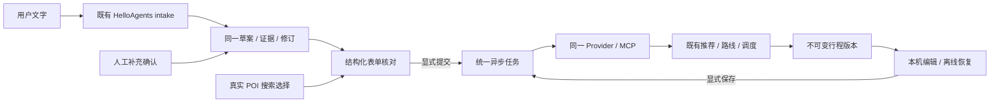

# 需求确认与 Web 连续使用

2026-10-22，优化计划 B 包。目标是把已有需求整理、逐日条件、真实选点、任务状态和版本调整接成一条可核对的流程。沿用同一个 FastAPI、HelloAgents intake、TravelClient、Provider/MCP 和推荐/调度算法；没有增加业务 Agent、前端算法或核心依赖。

## 用户流程

1. 结构化入口按“目的地与日期”“时段与交通”“可选约束与起终点”分组，仍可直接规划。需求整理是可选入口，模型不可用时不影响结构化表单。
2. 自然语言只整理草案。逐日时段/停留、交通分钟上限和起终点原文均可显示证据、来源与确认状态；不查询地点、路线或票价。
3. 在同一草案中补充、确认或清除条件。保存只更新草案修订，不创建规划任务、不再次调用模型。逐日数组整体替换，未勾选字段保留；天数冲突显式拒绝，不能自动丢掉某一天。
4. 先明确旅行天数再应用逐日草案。已知天数的部分日程保留空时间/停留，表单要求补齐；未提及的普通可选项使用可见表单默认值，默认不成为已确认原文。
5. 起终点文字只作线索，不进入 PlanRequest。用户经现有真实 POI picker 选择适用日期并点击“确认已选起终点”，或明确选择“本次仅按表单条件规划”。前者不代表系统已判断所选 POI 与原文相同，后者不包含未选一侧的路段。
6. 点击“开始规划”才提交。工作台顶部“规划流程”可以用键盘定位填写需求、执行状态、行程与调整的标题；实际进度、取消、超时与约束失败仍来自原任务接口。
7. 失败建议定位日期/时段/交通条件，修改后显式提交；成功后查看多日时间轴、路途负担和来源。编辑沿用本机草稿、离线同收据恢复、保存新版本与只读来源对照。

预约、未来营业、真实门票/库存等原文仍留在“人工处理”列表，不能由草案确认或保存成功宣称已满足。本轮没有新增这些业务字段。

## API 与数据流

接口数量仍为 20 个 travel 路径。扩展同一 `DraftValues`，其余规划/调整接口和已保存行程结构不变：

| 新增字段 | 草案语义 | 规划语义 |
| --- | --- | --- |
| `day_schedules` | 1–3 项，每项 `day_start` / `day_end` / `stay_minutes` 可空；无跨夜；已知 days 时长度相等 | 全部补齐后映入既有 `DaySchedule[]`，不补造默认 |
| `max_leg_travel_minutes` | 可空严格整数 1–1439 | 映入既有单段上限，真实路线验证 |
| `max_daily_travel_minutes` | 可空严格整数 1–1439 | 映入既有每日上限，含所选往返 |
| `origin_hint` / `destination_hint` | 可空用户原文，1–100 字；模型输出须出现在原文中 | 不映射 ID，必须真实搜索选择或显式按表单规划 |

`DraftField` 从 10 项扩为 15 项，证据/确认列表随之有界扩展；澄清历史接受结构化日程，仍只来自已校验的输入。部分日程即使已确认其表达，缺失子字段仍提问，不视为完整。合并冲突、空值确认、重复确认或旧修订写入均不改动当前草案。

OpenAPI 导出后生成 TypeScript 类型，Web 没有手改生成类型。旧草案缺少新字段时读取为空；旧请求、旧任务及旧保存版本保持兼容，不迁移或重写历史。

## 核对与恢复边界

起终点确认记录只在当前浏览器和账号保存用户决定，绑定草案 ID/修订、城市、出发日期、天数和每天起终点 ID。任一绑定条件变化都需重新确认，不储存 POI 坐标、折线或响应事实。

新草案不会静默覆盖已应用表单；新 ID 或新修订要求明确“填入最新草案”或“保留当前表单”。已应用草案恢复失败时同样阻止跳过核对，允许恢复连接或明确保留表单。未保存的草案补充仍沿用既有显式保存语义，不能当作已提交数据。

本次按职责提取 `PlanningForm`、`TaskExecution`、`WorkflowNavigation` 与 `DraftHandoff`；草案逐日确认提取为 `DraftDailyReview`。任务跟随、SSE/轮询、幂等提交和编辑状态保留既有入口与模块，不引入状态库。共用停留的表单类型允许临时空值，提交才通过既有严格校验；刷新不把空停留悄悄换成 60 分钟。

## 验收与交付

最终 Python 259、TS 62、三浏览器 258 次执行通过，共 407 个逻辑用例 / 579 次执行；类型/生产构建、20 路径 Schema 再生成一致性通过。九份完整浏览器报告核对预先发现的用例 ID、每例一次、零最终失败/跳过/自动重试与服务正常退出。详见 [ACCEPTANCE.md](../ACCEPTANCE.md)。B 包使用隔离 TEST ONLY 数据、无模型/Amap/JS SDK 密钥，外部调用为 0。后端测试覆盖实际 Function Calling 协议、原文依据、日程缺项、天数/合并冲突、来源/确认/清除、修订与旧记录兼容，不冒充真实模型调用。

新增浏览器完整链使用测试服务中的实际草案/任务/规划/SQLite 接口，地点选择专用响应明确标记 TEST ONLY。覆盖：

- 补充逐日条件及交通上限 → 显式规划 → 逐站编辑 → 刷新恢复 → 离线保存 → 同幂等标识恢复 → 新版本及来源只读对照；未知费用不视为免费。
- 部分日程与天数冲突保留原输入、空项不填默认、原文线索不变 ID；390 像素窄屏的键盘导航、错误摘要定位、确认恢复与条件变化重核对。
- 真实选点路径的显式确认、日期/地点变化后确认失效、刷新恢复及提交无 hint 字段。
- 新草案 ID、修订和上下文读取失败时的显式选择，不产生隐式规划提交。

三日十二站性能场景保留原门槛：切日 p95 < 1500 ms、单次 < 3000 ms、DOM < 3000、编辑草稿 < 32 KiB。当前未带基线的 p95 为 Chromium 110.4 / Firefox 149 / WebKit 290 ms；453074 字节带基线响应为 154 / 131 / 256 ms。草稿不含基线事实或折线，保存/刷新/原版本保留通过。这是本机生产构建、隔离测试数据、三引擎并发各一 worker 的测量，不是公网性能承诺。

初次构建暴露了旧表单类型只允许数字而实际控件可暂时为空，已在表单类型与提交边界修正。首次定向浏览器暴露流程按钮的完整可访问名称及起终点搜索控件定位不一致；修正稳定名称与实际标签控件定位，保留焦点断言。独立审查补齐了日期变化需要重新核对。原报告保留，未增大超时、性能阈值或自动重试。

真实高德/模型/JS SDK、公网 HTTPS、灾备和手机未在 B 包重跑。A 包的真实多城/direct/MCP 证据仍保留在 [POI_COMPARISON.md](POI_COMPARISON.md)，不混作本次验证。模型新提取字段的实际准确率需要另列授权模型样本和预算；本轮没有主观满意度反馈。

文档链接检查未新增断链；旧归档相对路径和已忽略历史图片的 13 个缺失引用记录在本地 `artifacts/b-workflow-doc-links.json`，不作为本包新增链接通过结果。源文件与生产构建检查不含服务私钥，测试数据不作为生产降级。

后续按 C 包整体验收选择受影响的 direct/MCP、账号、任务故障、地图代理、归档及本地部署/恢复检查；不因 B 包完成声称 App 或公网部署已经验收。

## 文件范围

| 范围 | 文件 |
| --- | --- |
| 草案契约与处理 | `backend/travel/schemas.py`、`backend/travel/drafts.py`、`backend/agent/travel_intake.py` |
| Web 交接与表单恢复 | `App.vue`、`draft.ts`、`handoff.ts`、`schedules.ts`、`session.ts` |
| Web 组件 | `RequestAssistant.vue`、`DraftDailyReview.vue`、`PlanningForm.vue`、`TaskExecution.vue`、`WorkflowNavigation.vue`、`DraftHandoff.vue` |
| 契约生成 | `packages/api-schema/openapi.json`、`schema.d.ts` 及其说明 |
| 验证 | 两个后端草案测试、`draft_constraints.test.ts`、`handoff.test.ts`、`browser/workflow.spec.ts`、根 `package.json`、`playwright.config.ts` |
| 交付文档 | README、使用手册、验收记录、发布范围、本说明与优化计划、发布清单 |
