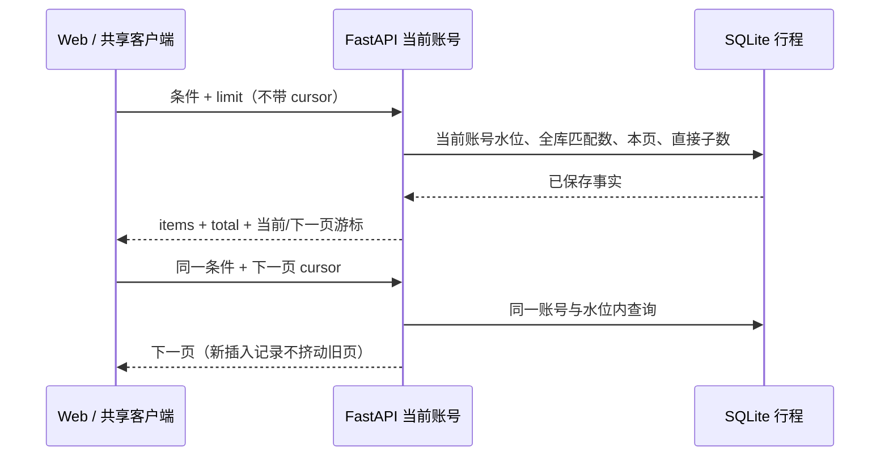

# 已保存行程：全库查询与分页

更新日期：2026-10-21。当前实现与本地验收以本文及 [ACCEPTANCE.md](../ACCEPTANCE.md) 为准。

## 页面行为

已保存行程按当前账号的全部记录搜索标题、城市、出发日期或版本 ID，可选原行程/调整版本、保存时间或出发日期排序。Web 每页 50 条，显示匹配总数、当前页与上一页/下一页；搜索和条件变化会从新查询第一页开始，输入有 250 毫秒合并等待。刷新保留条件，新快照成功读取后才替换为第一页，失败保留旧页；离开页面后查询状态不持久保存。后续焦点、状态提示与跨页失败保护见 [SAVED_PAGE_RECOVERY.md](SAVED_PAGE_RECOVERY.md)。

每张卡片的直接调整数量来自后端对当前账号全部快照记录的计数，不受搜索条件或当前页影响。查看直接调整版本会清除搜索和类型条件，并用真实 `parent_id` 查询；不包含孙版本。来源不在本页时仍可单独读取，沿用原有只读对照和未保存编辑保护。

读取期间不能重复翻页，筛选输入仍可继续修改。新条件立即使旧响应失效并取消旧请求；离开或换账号后也不能回填旧结果。读取失败提供显式重试，失败的翻页不会推进页码；刷新可重新开始。列表操作不提交业务任务，也不清理行程或编辑草稿。旧服务若缺少总数/计数字段，页面明确未提供，不将缺失计数当成零。

## API 契约

扩展既有 `GET /api/v1/travel/itineraries`，没有增加第二套业务服务。所有条件只作用于认证依赖确定的当前账号，客户端不能传入 owner 选择其他账号。

| 查询参数 | 范围与含义 |
| --- | --- |
| `limit` | 1–100，默认 50；Web 固定 50 |
| `query` | 最多 120 字符，首尾空白忽略；标题/城市/出发日期/自身 ID 的字面包含匹配 |
| `kind` | `all` / `original` / `adjusted`，默认 `all` |
| `order` | `newest` / `oldest` / `departure`，默认 `newest` |
| `parent_id` | 最多 100 字符，精确匹配直接来源；不递归推断版本链 |
| `cursor` | 最多 2048 字符，使用响应给出的当前页/下一页游标；换条件时清除 |

搜索对 ASCII 字母忽略大小写，中文按字面匹配；不提供拼音、模糊语义或所有 Unicode 大小写折叠。`%`、`_`、引号与反斜线均为字面字符，不作为通配或 SQL。所有用户输入作为 SQL 参数绑定。

响应保留 `items`，兼容旧客户端；新增 `total`、`page_cursor`、`next_cursor` 和 `direct_adjustment_counts`。总数是当前条件与快照内的匹配数；计数字典仅包含当前页版本的 ID，其值统计同账号快照内全部直接子版本。无下一页时 `next_cursor=null`。新增字段在模型中保留兼容默认值，实际当前服务会完整填充。

`page_cursor` 可返回当前快照的同一页，`next_cursor` 指向下一页。Web 保存已访问页游标以返回上一页，不用当前列表推算位置。共享客户端的查询参数类型直接引用生成的 OpenAPI `paths`，Web 与未来原生 transport 使用同一方法；无参数调用仍请求原 `/itineraries` 地址并返回最多 50 条。

## 查询与快照



复用现有不可变行程表、归属表和 Store 锁，不做数据库迁移。第一次查询记录当前账号的最大插入 rowid；后续页限制在此水位内，并使用稳定的排序与 rowid 决胜，避免同保存时间的记录跨页重复。新插入的原行程/调整版本只在刷新后的新查询中出现，也不改变旧快照里的子版本数量。

游标包含版本、水位、偏移和账号/条件指纹；拒绝格式错误、越界、换账号或换条件的游标，统一返回 422 `invalid_itinerary_cursor`。游标不是签名授权凭证；每次 SQL 仍独立限定当前账号，不能依靠游标读取他人记录。进程正常重启、同库重新打开可继续读取；替换数据库或回退恢复后应刷新，不承诺跨库快照连续性。

列表只解析当前页最多 100 个完整行程，匹配计数和排序在 SQLite 中执行，不把全部 POI/路线载入前端。当前 JSON 字段查询仍可能扫描当前账号历史，未将其称为百万记录性能验收；更大规模可另行评估索引或搜索表，不能据此引入业务数据副本或估算路线。

另修正历史保存时间的读取：新行程仍在创建时记录时间；旧 JSON 若缺 `created_at`，统一读为表示未提供的空字符串，页面显示“保存时间未提供”，并排序到保存时间列表末尾。读取不回写原记录，不用读取时刻冒充保存时刻。

## 本地验证

```powershell
python scripts/verify_repository.py
python scripts/verify_browser.py
python scripts/export_openapi.py
npm run schema:generate
python scripts/update_publish_manifest.py --check
# 定向检查
python tests/test_itinerary_listing.py -v
python scripts/verify_browser.py --browser chromium --suite local --grep "saved (versions|pagination)"
python scripts/verify_browser.py --browser chromium --suite auth
```

新增 Python 9 项：超过 50 条的完整遍历、字面搜索与注入字符、原/调整/直接父条件、全库计数、排序同值/缺时间、游标参数/账号约束、插入后的前后页稳定性、重开兼容，以及真实 HTTP 默认/校验/越权。新增共享客户端 2 项：生成类型参数的编码与取消信号，以及实际 HTTP 元数据/错误契约。

浏览器新增本地 3 场景与账号 1 场景：65 条历史的 50/15 双页及回退、排序与窄屏；搜索首屏之外的原版、读取跨页直接调整和对照；迟到搜索、列表失败重试且保留编辑；双账号的全库、外部 ID 搜索与游标拒绝。全部使用显式 TEST ONLY 临时库，固定历史记录不进入生产 Provider。

首轮账号回归两项旧测试仍等待“手动刷新后失效”，而进入保存页自动读取已即时触发原有 401 工作区关闭。trace 核对为实际已返回登录页，改为验证立即失效，再保留同账号草稿恢复与跨账号隔离断言；未放宽超时或启用重试。另一个新增检查错误地从旧接口默认最近 50 条的尾项寻找第 65 条历史，已改为显式范围并按 ID 核对，生产逻辑没有为测试改动。

本轮以独立临时库、真实高德直接 Provider 和生产 Web 构建复查南京两公园的原规划、调整保存、子版 ID 搜索、对照、打开来源与刷新，全部通过。停留从 30 改为 45 分钟，首站费用从未知到用户录入 0 元，完整预算仍未知；原记录逐字段不变。只产生原规划与调整两个业务 POST，后续查询没有 Provider 调用。调用路径上限 7，不是实测 Provider 次数。报告与桌面截图仅在本机 `artifacts/pagination-live/2026-10-21/`，临时数据库已清理，服务优雅退出。

65 条分页与账号边界属于隔离自动检查；真实样本只验证两个真实版本的现有链路，不声称完成 65 个真实行程的分页或主观推荐质量评估。本轮未重测 JS SDK、历史扩展质量矩阵、HTTPS、恢复演练或移动真机，未上传 GitHub。
