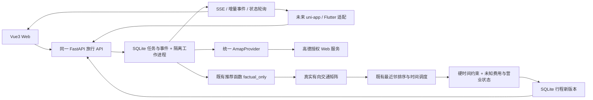

# TravelAgent Web 阶段交付

验证日期：2026-10-11。范围已按用户补充调整为 **先完成 Web，uni-app 后续增加**。本轮新增单 Agent 需求草案，见 [HelloAgents 实施与真实联调记录](HELLOAGENTS_INTAKE.md)。

2026-10-16 增量：已实现同一草案的多轮补充、字段确认和修订冲突保护；当前运行端口、API 增量与本轮检查见 [需求澄清闭环](DRAFT_CLARIFICATION.md)。下表历史结果保留各阶段证据边界。

## 1. 审计与工程整理

详见 [架构审计](TRAVEL_ARCHITECTURE_AUDIT.md)。实际客户端是 Flutter，并无 uni-app；现有 Flutter、业务代码和数据文件全部保留。新增 Vue3/TypeScript/Vite 工作台和同一 FastAPI 应用内的旅行 API。没有第二套 Agent，也没有前端推荐/路线算法。

旧数据路径保留用于本地兼容与回归；新的旅行 API 不读取它们。部署旅行服务时设置 `TRAVEL_PRODUCTION=1`，旧 `/api/route/`、`/api/map/`、`/api/eval/`、`/api/context/` 入口返回 410，防止旧模拟数据和估算降级成为生产业务结果。现有 Flutter 仍可在开发模式调用旧接口；生产模式下需后续接入新旅行 API。

```text
apps/
  web/                    PC 工作台，Vue3 + TypeScript + Vite
  mobile/README.md        后续 uni-app 接入预留（不是可运行 App）
packages/api-schema/
  openapi.json            由 FastAPI 导出的旅行 API 快照
  schema.d.ts             openapi-typescript 生成的类型
  client.ts               Web/未来 App 共用的 transport 客户端与轮询
backend/
  travel/                 Schema / Provider / Tools / MCP / Planner adapter / Tasks / SQLite / API
  services/               复用既有推荐、最近邻排序、时间调度
  agent/                  既有受控 Agent + HelloAgents intake + 真实工具桥接
  data/                   本地 SQLite，忽略提交
lib/ android/ windows/    现有 Flutter，未迁移
scripts/                  OpenAPI 导出、真实 API 验证
tests/                    与生产运行隔离的契约/生命周期测试
```

## 2. API Schema

API 前缀 `/api/v1/travel`，服务的 `/docs` 和 `/openapi.json` 包含完整定义。源模型为 `backend/travel/schemas.py`。前端直接引用生成类型，不手写另一套 POI/行程定义。

| 方法 | 路径 | 契约/行为 |
| --- | --- | --- |
| GET | `/capabilities` | Key 是否配置、已支持模式、缺失能力；不返回密钥 |
| POST | `/drafts` | 用户原文与参考日期 → 202 Task(kind=draft)，只整理需求 |
| GET | `/drafts/{id}` | 用户需求草案、原文依据、缺失问题与待处理要求 |
| PATCH | `/drafts/{id}` | expected_revision + 用户变更/确认 → 同一 Draft 的新修订；冲突 409，不调用模型或自动规划 |
| POST | `/tasks` | `PlanRequest` → 202 `Task`，立即返回任务 ID |
| GET | `/tasks/{id}` | 查询真实任务状态和错误/行程 ID |
| POST | `/tasks/{id}/cancel` | 取消并终止工作进程；已终态请求幂等 |
| GET | `/tasks/{id}/events?after=N` | 增量事件，用于 App 兼容轮询 |
| GET | `/tasks/{id}/events/stream` | GET SSE，`progress`、`terminal`、心跳；支持 Last-Event-ID |
| GET | `/itineraries` | 已保存行程，默认最近 50 条 |
| GET | `/itineraries/{id}` | 完整多日行程、费用缺失项与约束提醒 |
| POST | `/itineraries/{id}/adjust` | 每日 POI ID 顺序、逐站时长、用户费用、日期/时段/交通/预算 → 202 新任务；保留原版本 |
| GET | `/pois?keyword=...&city=...` | 真实高德搜索，最多 20 个有效带坐标地点 |
| GET | `/pois/{id}` | 真实高德详情 |
| POST | `/routes` | GCJ-02 起终点 → 真实步行/驾车路线，缺失不估算 |

任务状态：`queued → running → succeeded / failed / timed_out / cancelled`。规划默认总时限 180 秒，草案最多 45 秒，均含排队时间；并发 2，最多 10 个未结束任务。服务重启后将未完成任务标记 `service_restarted`，已保存结果保留。任务工作进程与 API 隔离；取消和超时终止进程，不会继续在后台保存结果。Task.kind 默认 plan；draft 任务成功只返回 draft_id，不生成 itinerary_id。

统一错误示例：

```json
{"error":{"code":"provider_not_configured","message":"未配置高德 Web 服务 Key；无法查询真实数据","retryable":false}}
```

任务错误保存在 `Task.error`，HTTP 校验错误为 422，Provider 未配置为 503，超时/调用失败为明确错误。对外不暴露带 Key 的 URL 或原始异常。

核心数据：`Poi.source` 包含 Provider、查询时间和 GCJ-02 坐标系；缺失评分、人均消费、营业时间为 `null` 并列入 `missing_fields`。`Segment` 保存真实距离、分钟数与 Provider 路网折线。`Stop.stay_minutes` 来自用户输入；费用只接受显式用户录入，不将高德人均消费当成门票。

预算为 `known_subtotal` + `unknown_items`，总额保持 `null`。已知费用超上限时为 `exceeded`，其余为 `unknown`；不会以未知价格为零宣称满足预算。每日结束时间是硬约束，超出则任务失败，提示减少停留或站数。

## 3. 数据流



Web 使用 SSE 展示进度并同时轮询终态，SSE 断线时轮询继续工作。后续 App 可只使用同一客户端轮询接口。请求默认 15 秒超时，轮询总时限 210 秒；AbortSignal 会取消正在进行的 HTTP 请求。刷新后按本机保存的任务、草案和行程 ID 恢复查询，仅保存用户表单和 ID，不缓存 Provider 数据或密钥。

自然语言先经过 HelloAgents FunctionCallAgent → 既有 ToolRegistry 校验字段及原文依据 → RouteCoordinator 检查信息 → 保存需求草案。用户填入表单并核对后才创建规划任务。草案 Agent 不查询地点、路线或预约；不存在由模型生成交通成本的步骤。

REST、规划进程、Function Calling 分发与本地 MCP 工具都通过 `travel/tools.py` → `AmapProvider`。`TravelTools.function_definitions()` 由 Pydantic 生成三项工具参数 Schema，`invoke()` 只接受白名单工具，参数错误或外部数据缺失均明确失败。可选 MCP 1.26.0 使用独立 stdio 进程；不创建第二套 Agent、API、数据库或规划算法。`mcp_available` 仅表示 SDK 可导入，`mcp_connected=false` 表示旅行规划目前未通过 MCP 客户端执行，不能把安装 SDK 当作 Agent 接通。

推荐复用 `ranker_engine.rank_pois(..., factual_only=True)`；屏蔽默认排队、评论、价格及体验分的参与。排序复用 `route_planner._optimize_order_by_distance` 的新增可选距离函数；调度复用 `_build_route_stops` 与已有 `planning_distance_matrix`。原默认参数与算法行为保持兼容。

本阶段先按推荐顺序分到每天，再逐日优化；最多 3 天、每天 4 站，最多 36 次有向路径请求。实际业务会消耗授权配额，任一必要路线缺失就失败；不自动构造交通矩阵。

## 4. Web 运行

在仓库根目录 `D:\jupyter\MT`：

```powershell
python -m venv .venv
.\.venv\Scripts\python.exe -m pip install -r backend\requirements.travel.lock.txt
npm ci --cache .cache/npm
```

既有 `backend/requirements.txt` 未修改；新锁文件记录本次独立环境验证版本。Node 建议 22.12+；本次使用 Node 26.3.0、Python 3.12。

现在可不配置高德 Key 继续开发和运行工作台，搜索/规划返回明确的数据不可用错误。授权后在 `backend/.env` 填写自己的高德 **Web 服务** Key `AMAP_WEB_KEY` 或进程环境 `AMAP_KEY`，然后重启后端。该凭证只留在后端。无需 LLM Key 即可执行本阶段结构化规划。

浏览器地图需另一个 **JS API** Key 与安全配置，复制 `apps/web/.env.example` 为 `.env.local` 并填写公开的 `VITE_AMAP_JS_KEY`；后端填写相同的 `AMAP_JS_KEY` 和 `AMAP_JS_SECURITY_CODE`，启用相应域名白名单。已改为同源安全密钥代理，迁移步骤见 [AMAP_PROXY.md](AMAP_PROXY.md)。不要把后端 Web 服务 Key 或安全密钥填入 VITE 变量。缺少 JS Key 时显示地图配置空态，POI、时间轴和任务 API 不受影响。详情与搜索字段仍受账号权限和配额限制。

分别开两个终端：

```powershell
# 后端（必须单实例、单 worker）
.\.venv\Scripts\python.exe -m uvicorn main:app --app-dir backend --host 127.0.0.1 --port 8000
```

```powershell
# Web
npm run dev
```

访问 `http://127.0.0.1:5173/`。开发代理 `/api` 指向 `http://127.0.0.1:8000`；可用 `TRAVEL_BACKEND_URL` 改目标。`npm run build` 生成 `apps/web/dist/`。

## 5. App 运行与接入边界

本次未创建 uni-app；`apps/mobile` 仅说明和目录预留，不能作为 App 启动。现有 Flutter 可在安装兼容 SDK 后运行：

```powershell
flutter pub get
flutter run -d windows
# 或 flutter run -d <Android 设备 ID>
```

本机无 PATH 中的 Flutter SDK，旧 `flutter.ps1` 指向的 `G:\dev\flutter\bin\flutter.bat` 也不存在，故没有宣称完成 App 构建或双端真机联调。Flutter 默认 mock 降级仍关闭；保留其代码与旧接口供本地回归。

未来 uni-app 通过 `uni.request` 实现 `client.ts` 的 Transport，复用生成类型与轮询，接入说明见 [apps/mobile](../../apps/mobile/README.md)。移动端不添加 Agent、Provider 或业务算法。

## 6. 实际验证结果

| 验证 | 本次结果 | 证据边界 |
| --- | --- | --- |
| `python tests/test_travel.py -v` | 13/13 通过 | 配置错误、来源字段、密钥脱敏、交通矩阵注入、逐站调度、工具白名单、跨天调整/约束/预算清除、版本保存、202/SSE/轮询、持久化、超时/取消/容量/重启 |
| `python tests/test_agent_intake.py -v` | 6/6 通过 | 实际 HelloAgents 框架，隔离 MockTransport；原文依据/契约、越权/重复调用、缺配置无降级、受控桥接、草案持久化 |
| 原有 `run_offline_evaluation()` | 49/49 通过 | 当前既有数据集的意图/修改/workflow/质量/失败/修复回归；不是授权数据验证 |
| `npm run build` | 类型检查和构建通过 | Vue3 编译、OpenAPI 类型消费 |
| `npm run test:client` | 6/6 通过 | 实际 uvicorn 缺 Key HTTP/SSE、禁用解析；挂起 HTTP 取消/超时；用户表单恢复；Vue 数字费用、未知费用与草案填入 |
| `python tests/test_mcp.py -v` | 1/1 通过 | 真实 stdio initialize/list_tools/call_tool，三项工具缺 Key、参数错误、structuredContent 与 isError；未请求高德 |
| 浏览器正式服务 | 已验证 | 实际缺 Key 表单/POI 错误；真实 HelloAgents 模型需求草案异步保存并填入表单；正式库无测试行程 |
| 真实模型独立调用 | 已成功 | 普通旅行需求的一次 Function Calling，未查询高德；记录在 artifacts/live-intake-verification.json |
| 浏览器独立测试服务 | 已验证 | TEST ONLY 输入、隔离库与端口；跨天移动、90 分钟停留、88 元费用、日期改动/驾车/预算清除、新版本保存及刷新恢复；不是高德成功联调 |
| `npm audit` | 0 漏洞 | 新 Web 依赖锁定并核验 |
| 高德真实成功链路 | 未完成 | 当前无高德 Web 服务和 JS API 授权 Key |
| App / 双端真机联调 | 未执行 | 用户改为先做 Web；uni-app 不存在，Flutter SDK 不可用 |

成功规划、编辑、持久化的测试使用 **仅在 tests 内注入的 FixtureProvider**，测试数据库为临时文件；浏览器测试脚本必须显式加 `--test-fixtures-only`，绑定 localhost:8001 并使用 `.tmp/browser-test.sqlite3`，与正式端口/数据库分离。生产入口没有可配置的测试 Provider、fixture 模式或模拟数据降级。不能将这些测试当作真实高德成功联调。真实模型需求草案另已通过正式 Web 联调；用户需求没有被当成实际地点或路线。MCP 运行见 [上一轮增量](WEB_CONTINUATION.md)，HelloAgents 配置与实测见 [本轮记录](HELLOAGENTS_INTAKE.md)。共享客户端负路径测试须对禁用解析且未配置高德的服务运行；不会消耗真实模型或高德配额。

配置合法 Key 后，可执行真实成功链路验证（会调用高德授权 API）：

```powershell
.\.venv\Scripts\python.exe scripts\verify_live_travel.py --city 北京 --keyword 博物馆 --date 2026-10-11
```

脚本检验 POI 和交通来源都为 `amap`，成功后输出忽略提交的 `artifacts/live-travel-verification.json`。缺 Key/失败不会输出虚假的成功记录。

## 7. 数据来源与缺失能力

| 内容 | 来源 | 当前状态 |
| --- | --- | --- |
| 地点 ID/名称/地址/分类/坐标 | 高德搜索/详情，GCJ-02 | 接口已接入，真实账号验证待 Key |
| 评分/人均消费/营业时间 | 高德实际返回字段 | 可能缺失或受权限限制；null，非门票、不生成评论 |
| 路线距离/时长/路网折线/可用过路费 | 高德 walking/driving | 有向矩阵，缺失失败；未来日期耗时不作承诺 |
| 日期/预算/每日时段/停留时长/站点费用 | 用户显式输入 | 标记用户来源；站点消费可编辑 |
| 行程与调整历史 | 本机 SQLite | 保存真实 API 与用户输入派生结果，保留父版本 |
| 需求草案 | 用户原文 + HelloAgents 结构化提取 | 字段附原文依据，仍须人工核对；不作为真实 POI/价格/路线来源 |
| 真实评论、拥挤、排队 | 无授权来源 | 不使用旧模板 UGC，能力缺失 |
| 门票/酒店报价、库存、预约 | 无授权来源 | 总预算无法完整核验，能力缺失 |
| 公交/地铁、跨城交通 | 本阶段未接入 | 不用速度公式替代，仅支持步行/驾车 |
| 出行日期营业/闭馆/预约时间窗 | 未授权/未校验 | 提示待人工确认，不能声明行程完全可执行 |
| 全局多日优化、始发酒店、回程和用餐约束 | 尚未适配 | 当前逐日排序与时段约束 |
| MCP 协议 / Function Calling 工具 | 已实现可选 MCP stdio 与 typed 分发 | REST/Planner 共用同一 Provider，协议负路径已验证 |
| HelloAgents / Function Calling Agent | 单 Agent 需求草案已实测 | 既有 Coordinator/Registry 边界；真实模型与 Web 联调成功，确认后路线仍由既有算法计算 |

## 8. 后续任务划分

1. **授权联调**：配置账号、Key、域名与配额；执行真实 POI/路线/编辑成功验证；按实际权限补 Provider 字段和限流/缓存。
2. **既有 Agent 接入工具**：ToolRegistry 到同一 typed gateway 的受控桥接已完成；后续扩展经验证的真实工具使用和来源事件，不启用旧模板 UGC 工具。不能用模型“补”事实。
3. **HelloAgents 单 Agent 扩展**：本轮已完成需求提取、字段校验与 RouteCoordinator 澄清判定；后续增加可控澄清交互和实际 MCP 客户端连接验证，继续复用路线算法。凭证只在后端。
4. **App 接入**：拿到或新增 uni-app UI，采用共享 OpenAPI 类型与 uni.request transport；随后适配现有 Flutter 新 API；完成 Web + 真机 App 同后端验证。
5. **生产部署**：账号与权限隔离、鉴权、限流、HTTPS、授权数据保留策略、共享持久化队列及多实例恢复。当前 SQLite 单实例不是多用户部署方案。
6. **进阶能力**：跨日全局优化、日期营业约束、真实库存价格，再推进复杂多 Agent、Memory 与评估。高级模块后置。

部署静态 Web 需用同域反向代理将 `/api` 转发后端，对 SSE 关闭缓冲并允许长连接。设置 `TRAVEL_PRODUCTION=1` 关闭旧非真实数据入口；API 当前仅绑定 localhost，不应未经鉴权就对公网开放。

## 9. 新增及修改文件

见下方自动列出的本阶段文件清单。未删除现有代码，未更改 `backend/requirements.txt`、Flutter 依赖或应用页面。

<!-- file-manifest -->

| 状态 | 文件 |
| --- | --- |
| 修改 | `.gitignore` |
| 修改 | `README.md` |
| 修改 | `backend/.env.example` |
| 修改 | `backend/main.py` |
| 修改 | `backend/services/amap_client.py` |
| 修改 | `backend/services/ranker_engine.py` |
| 修改 | `backend/services/route_planner.py` |
| 新增 | `apps/mobile/README.md` |
| 新增 | `apps/web/.env.example` |
| 新增 | `apps/web/index.html` |
| 新增 | `apps/web/package.json` |
| 新增 | `apps/web/src/App.vue` |
| 新增 | `apps/web/src/api.ts` |
| 新增 | `apps/web/src/components/RequestAssistant.vue` |
| 新增 | `apps/web/src/components/RouteMap.vue` |
| 新增 | `apps/web/src/draft.ts` |
| 新增 | `apps/web/src/editor.ts` |
| 新增 | `apps/web/src/main.ts` |
| 新增 | `apps/web/src/session.ts` |
| 新增 | `apps/web/src/style.css` |
| 新增 | `apps/web/tsconfig.json` |
| 新增 | `apps/web/vite.config.ts` |
| 新增 | `backend/agent/travel_intake.py` |
| 新增 | `backend/agent/travel_tool_bridge.py` |
| 新增 | `backend/requirements.helloagents.lock.txt` |
| 新增 | `backend/requirements.helloagents.txt` |
| 新增 | `backend/requirements.mcp.lock.txt` |
| 新增 | `backend/requirements.mcp.txt` |
| 新增 | `backend/requirements.travel.lock.txt` |
| 新增 | `backend/travel/__init__.py` |
| 新增 | `backend/travel/api.py` |
| 新增 | `backend/travel/drafts.py` |
| 新增 | `backend/travel/mcp_server.py` |
| 新增 | `backend/travel/planner.py` |
| 新增 | `backend/travel/provider.py` |
| 新增 | `backend/travel/runtime.py` |
| 新增 | `backend/travel/schemas.py` |
| 新增 | `backend/travel/store.py` |
| 新增 | `backend/travel/tasks.py` |
| 新增 | `backend/travel/tools.py` |
| 新增 | `backend/travel/worker.py` |
| 新增 | `docs/architecture/DRAFT_CLARIFICATION.md` |
| 新增 | `docs/architecture/HELLOAGENTS_INTAKE.md` |
| 新增 | `docs/architecture/TRAVEL_ARCHITECTURE_AUDIT.md` |
| 新增 | `docs/architecture/TRAVEL_DELIVERY.md` |
| 新增 | `docs/architecture/WEB_CONTINUATION.md` |
| 新增 | `package-lock.json` |
| 新增 | `package.json` |
| 新增 | `packages/api-schema/README.md` |
| 新增 | `packages/api-schema/client.ts` |
| 新增 | `packages/api-schema/openapi.json` |
| 新增 | `packages/api-schema/schema.d.ts` |
| 新增 | `scripts/export_openapi.py` |
| 新增 | `scripts/verify_live_clarification.py` |
| 新增 | `scripts/verify_live_intake.py` |
| 新增 | `scripts/verify_live_travel.py` |
| 新增 | `tests/browser_fixture_server.py` |
| 新增 | `tests/client.integration.test.ts` |
| 新增 | `tests/client.lifecycle.test.ts` |
| 新增 | `tests/test_agent_intake.py` |
| 新增 | `tests/test_draft_clarification.py` |
| 新增 | `tests/test_mcp.py` |
| 新增 | `tests/test_travel.py` |
