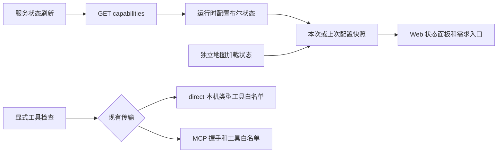

# Web 服务状态与恢复

日期：2026-10-23。继 A/B/C 后，本组集中完善真实服务的日常使用入口；继续保留同一后端、现有 Agent 和路线算法，不新增移动客户端或上传 GitHub。

## 使用方式

工作台顶部“服务状态”可查看地点与路线、地图展示、自然语言需求整理和数据工具。刷新只读取 `/api/v1/travel/capabilities`，不创建任务、不搜索地点、不计算路线、不调用模型，也不清空规划或需求输入。读取失败时自动展开状态说明；非阻塞的配置读取使用单一、命名的普通状态提示，账号等显式操作失败保留独立错误提示。

- 首次读取中、读取失败、当前配置和上次配置分别显示。未连接到后端时不能判断授权是否缺失；失败的刷新保留上次读取时间，并明确当前状态待确认。
- 地点与路线的“授权已配置”只表示服务存在凭证，不能证明权限、配额或上游网络可用。
- 浏览器地图配置、后端地图代理配置和地图组件加载结果分别说明。地图首绘完成后才标记组件已加载；底图与域名授权仍以实际地图结果为准。
- 自然语言整理分别说明服务开关、适配依赖和模型配置。不具备条件时可以继续填写表单；刷新失败不把旧配置当作当前可调用依据。已有草案和行程保留。
- 浏览器断网会使配置快照失效。恢复网络后重新读取配置，任务与收据仍沿用原恢复流程，不自动新建规划。

地图加载或绘制失败时显示“重试加载地图”，只在用户点击后重试。SDK 加载失败后重置其已失败的加载状态；仅绘制失败时复用已加载 SDK。清理残留画布，避免重复点击和组件卸载后的迟到结果影响当前页面。失败时仍能使用时间轴和地点列表；没有浏览器地图 Key 时不请求 SDK。正在等待 SDK 回调时保留加载状态，不能据此保证底图已经连通。

账号模式尚无首账号时，管理员按 [运行手册](OPERATIONS.md) 创建账号后，可点击登录页“重新检查账号配置”。它只重新读取账号状态并清空密码，不创建账号或登录会话。连接读取失败也可显式重新连接。

## 契约与数据流

`Capabilities.map_proxy_configured: bool = false` 是新增兼容字段。API 读取当前运行中的 `app.state.map_proxy.configured`，与地图代理实际参数校验复用同一条件；不会返回 Key、安全密钥、文件路径或环境变量值。`configured` 继续只表示高德 Web 服务配置，不混用为浏览器地图状态。

直接查询的工具检查不再依赖可选 MCP，也不创建 Provider。MCP 模式仍执行既有握手，不切换到其他传输。旧 `ToolServiceStatus.mcp_state` 字段为兼容保留；Web 根据 `transport` 将 direct 的结果显示为“后端工具检查通过”，MCP 显示为“工具协议检查通过”。两者均不代表真实数据授权校验成功。

OpenAPI 和 TypeScript 类型由后端重新生成。服务状态不持久化到浏览器，账号退出或卸载后忽略迟到读取；单次刷新共享请求，断网前的旧结果不能覆盖恢复后的新结果。

## 修改范围

| 范围 | 文件 |
| --- | --- |
| 兼容能力接口与运行时判定 | `backend/travel/api.py`、`schemas.py`、`map_proxy.py` |
| 现有传输工具检查 | `backend/travel/tool_runtime.py` |
| 状态快照与集中说明 | `apps/web/src/serviceStatus.ts`、`components/ServiceStatusPanel.vue`、`App.vue` |
| 地图绘制与手动恢复 | `components/RouteMap.vue`、`mapLoading.ts` |
| 自然语言入口、账号与工具提示 | `components/RequestAssistant.vue`、`components/ToolConnection.vue`、`WorkspaceRoot.vue` |
| 共享生成契约 | `packages/api-schema/openapi.json`、`schema.d.ts` |
| 回归与入口 | `tests/test_map_proxy.py`、`test_travel.py`、`service_status.test.ts`、`map_loading.test.ts`、`tests/browser/services.spec.ts`、`auth.spec.ts`、`workspace.spec.ts`、`package.json`、`playwright.config.ts` |
| 验收日志兼容 | `scripts/verify_repository.py` 将父进程结果转发统一为 UTF-8，避免 Windows GBK 无法编码 Node 的结果标记 |

运行方法仍见根 [README](../../README.md) 和 [Web 使用手册](../USER_GUIDE.md)。本组不修改凭证文件、任务算法、数据库格式、付费调用上限或依赖版本。

## 验证记录

完整回归使用独立组 `web-services-accepted-20261023`。C 包历史验收继续保留原日期和源码绑定，不能当作本组修改后的新验收。

| 已通过检查 | 实际结果 |
| --- | --- |
| 仓库完整检查 | 30 个 Python 套件共 300 项、共享客户端/展示逻辑 75 项；Schema、类型及生产构建一致 |
| 三引擎完整浏览器检查 | 每引擎 local 51、auth 15、resilience 26；九份报告共 276 次执行 |
| 生产构建本地 HTTPS | 29 项；API/Caddy 正常退出、临时目录清理、TLS 校验和源码上下文核对通过 |
| 安全与文档 | 受控源导出 Gitleaks 0 findings；后端私密值在源/构建中 0 匹配；294 个源文档相对链接无缺失 |

仓库与浏览器合计 **467 个逻辑用例、651 次执行**，零最终失败、跳过或自动重试。地图状态机使用明确 TEST ONLY 的 SDK 生命周期对象验证首绘错误和重试；浏览器服务状态使用配置/故障注入及无 Key 的地图区域，不能当作新一次真实 SDK、模型或高德授权验收。实际依赖版本和业务调用额度保持原值，未操作个人数据库。

本组报告位置（本机忽略产物，不提交 Git）：

- `artifacts/repository-runs/web-services-accepted-20261023/report.json`、`artifacts/web-services-accepted-repository.log`；父进程特意设置 GBK，实际完整输出与终态通过。
- `artifacts/browser-runs/web-services-accepted-20261023/<engine>/<suite>/` 及同组 `summary.json`，包含当前源码、计划用例、原始报告哈希和服务正常退出状态。
- `artifacts/drill-runs/web-services-accepted-20261023/deployment/` 与 `recovery/`，各自保留执行、逐项结果及正常关闭/清理记录。
- `artifacts/releases/<commit>/TravelAgent.zip`、`SHA256SUMS`、`runtime.json`；归档启动使用空的隔离库。
- `artifacts/candidate-runs/web-services-accepted-20261023/report.json`：统一核对同一归档、源码、Web 字节及完整恢复证据，只有 `status=passed` 才可作为绑定通过记录。复现沿用 [发布候选综合验收](LOCAL_RELEASE_CANDIDATE.md) 的命令并使用新的运行编号，不能覆盖旧组。
- `artifacts/web-services-panel-desktop.png`、`web-services-panel-narrow.png` 是 TEST ONLY 环境的大屏与 390 像素面板展示，已人工检查文字换行和操作区域。

已保留修复前证据：原地图组件在首绘抛错后错误遮罩不可见；首账号页面缺少重新检查按钮；第一组完整浏览器运行的离线退出同时出现两个紧急提示，导致原账号错误断言无法区分。修复后定向的状态 4 项和离线退出 1 项通过，保留原服务端身份及退出后权限断言。第一次仓库运行还暴露父进程 GBK 转发错误，改为 UTF-8 后以 GBK 启动新完整运行核验；一次脱离隔离 API 的手动共享 HTTP 测试连接失败也不计入正式通过统计。失败目录没有覆盖，不能将预备运行混作最终证据。
